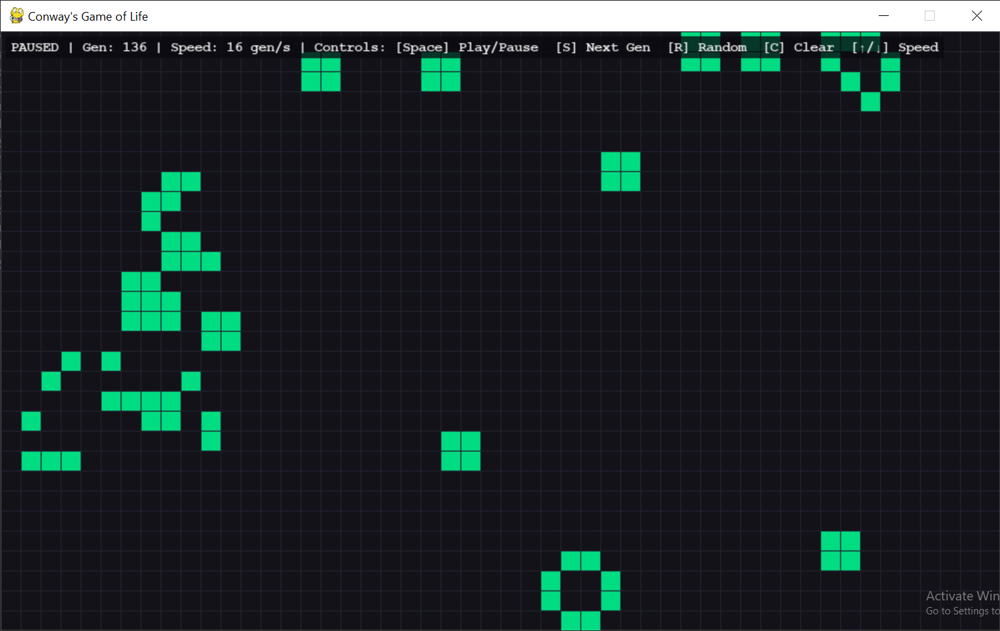

# Game-of-Life




An interactive desktop implementation of Conway's Game of Life built in Python and Pygame. Features a modular simulation engine that computes generation updates from cellular automaton rules, complete with user-controllable playback, interactive cell drawing, and pattern experimentation.

---
## Why I Made This

I chose to build **Conway's Game of Life** because it demonstrates how simple, predictable rules in code can simulate complex, real-world systems.

In biology, complex ecosystems and living organisms aren't controlled by a central brain directing every single piece; they emerge naturally from basic interactions between individual units. Conway's Game of Life captures that exact idea on a digital canvas. With just four simple neighborhood rules, simple cells can group together, survive, compete for space, and form moving, lifelike structures.

Building this project was a chance to see that emergence firsthand—learning how to translate basic mathematical rules into code and watch decentralized, living patterns evolve on their own.

---

## Features
- **Simulation Controls**
- **Real Time HUD**
- **Unit Tested**
- **Interactive Editing**

---

## Conway's Rules
Every cell interacts with its eight surrounding neighbors according to four simple rules:

1. **Underpopulation:** A live cell with fewer than 2 live neighbors dies.
2. **Survival:** A live cell with 2 or 3 live neighbors lives on to the next generation.
3. **Overpopulation:** A live cell with more than 3 live neighbors dies.
4. **Reproduction:** A dead cell with exactly 3 live neighbors becomes a live cell.

---

## Controls

| Key / Action | Function |
|---|---|
| **Left Click & Drag** | Draw / revive cells |
| **Right Click & Drag** | Erase / kill cells |
| **Space** | Start / Pause simulation |
| **S** | Step forward one generation (when paused) |
| **R** | Randomize grid |
| **C** | Clear grid and reset generation counter |
| **Up Arrow ($\uparrow$)** | Increase speed (generations per second) |
| **Down Arrow ($\downarrow$)** | Decrease speed (generations per second) |

---

## Project Structure

```text
Game-of-Life/
├── main.py              # Main loop, timing, and event handling
├── simulation.py        # Conway's rules, grid operations, and math logic
├── renderer.py          # Pygame drawing pipeline and HUD rendering
├── config.py            # Global dimensions, frame rates, and color palette
├── patterns.py          # Preset cellular configurations (Glider, Blinker, etc.) - Not yet done 
├── README.md           
└── tests/
    ├── test_renderer.py
    └── test_simulation.py # Unit tests for rule verification

```

---

## How to Run

### Prerequisites
- Python 3.8+ installed

### Installation and Lunch
1. Clone Repository
```bash
git clone https://github.com/TRI-DevLab/Game-of-Life.git

```

2. Install Pygame
```bash
pip install pygame

```

3. Run Visualizer
```bash
python main.py

```

